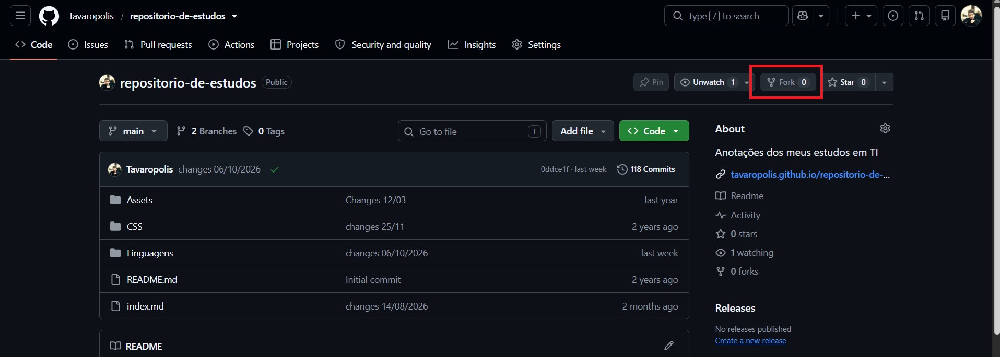

<link rel="stylesheet" type="text/css" href="../../../CSS/dark-theme.css">

[Anotações](../../) > [Fundamentos](../Index.md) > [Git](./Index.md) > [GitHub Fork](./GitHubFork.md)

# GitHub Fork

- [O que é um Fork](#o-que-é-um-fork)
- [Criando um Fork](#criando-um-fork)
- [Clonando o Fork](#clonando-o-fork)
- [origin e upstream](#origin-e-upstream)
- [Sincronizando o Fork](#sincronizando-o-fork)
- [Contribuindo com um projeto](#contribuindo-com-um-projeto)
- [Fork, Clone e Branch](#fork-clone-e-branch)
- [Principais comandos](#principais-comandos)

Um **Fork** é uma cópia de um repositório GitHub criada na sua própria conta. Ele permite que você desenvolva alterações em um projeto sem precisar ter permissão para modificar diretamente o repositório original.

É muito utilizado quando queremos contribuir com projetos de outras pessoas, especialmente em projetos de código aberto.

## O que é um Fork

Imagine que você encontrou um projeto no GitHub e deseja implementar uma nova funcionalidade.

O repositório original pertence a outra pessoa, e você não possui permissão para enviar alterações diretamente para ele.

Nesse caso, você pode criar um Fork:

```text
Sua conta no GitHub             Conta do autor
        │                             │
        │                             │
        ▼                             ▼
Seu Fork  ◄──────────────────  Repositório original
        │
        ▼
Você pode desenvolver
suas próprias alterações
```

O Fork cria uma cópia do repositório na sua conta do GitHub. A partir dela, você pode fazer alterações e, se desejar, propor que elas sejam incorporadas ao projeto original.

## Criando um Fork

Para criar um Fork:

1. Acesse o repositório desejado no GitHub.
2. Clique no botão **Fork**.
3. Selecione a conta ou organização em que deseja criar a cópia.
4. Confirme a criação.



Após isso, você terá um repositório próprio no GitHub, associado ao projeto original.

Por exemplo, se o repositório original for:

```text
https://github.com/autor/projeto.git
```

Seu Fork poderá ficar em:

```text
https://github.com/seu-usuario/projeto.git
```

O Fork é criado no GitHub. Para trabalhar com ele localmente, você ainda pode precisar executar um `git clone`.

## Clonando o Fork

Depois de criar o Fork, você pode cloná-lo para seu computador:

```bash
git clone https://github.com/seu-usuario/projeto.git
```

Entre na pasta criada:

```bash
cd projeto
```

Normalmente, o Git configura o remote `origin` apontando para o seu Fork:

```text
origin → https://github.com/seu-usuario/projeto.git
```

Assim, você pode trabalhar localmente, criar branches, fazer commits e enviar alterações para seu próprio repositório.

## origin e upstream

Ao trabalhar com Forks, é comum utilizar dois remotes.

- **`origin`:** normalmente aponta para o seu Fork.
- **`upstream`:** normalmente aponta para o repositório original.

Depois de clonar seu Fork, adicione o repositório original como `upstream`:

```bash
git remote add upstream https://github.com/autor/projeto.git
```

Verifique os remotes configurados:

```bash
git remote -v
```

Exemplo:

```text
origin    https://github.com/seu-usuario/projeto.git (fetch)
origin    https://github.com/seu-usuario/projeto.git (push)
upstream  https://github.com/autor/projeto.git (fetch)
upstream  https://github.com/autor/projeto.git (push)
```

Nesse cenário:

```text
Seu computador
     │
     ├── origin ────→ Seu Fork no GitHub
     │
     └── upstream ──→ Repositório original
```

Os nomes `origin` e `upstream` são convenções, não palavras reservadas. Você pode utilizar outros nomes, desde que saiba a qual repositório cada um se refere.

## Sincronizando o Fork

Imagine que o autor do projeto original publicou novas alterações. Seu Fork não recebe necessariamente todas essas atualizações de forma automática.

Para buscar as informações mais recentes do repositório original:

```bash
git fetch upstream
```

Supondo que você queira atualizar sua branch local `main` com as alterações de `upstream/main`, estando nela e sem alterações locais pendentes:

```bash
git switch main
git merge upstream/main
```

Depois, envie a atualização para seu Fork:

```bash
git push origin main
```

O fluxo é:

```text
Repositório original
        │
        │ git fetch upstream
        ▼
Seu repositório local
        │
        │ git merge upstream/main
        ▼
Branch local main atualizada
        │
        │ git push origin main
        ▼
Seu Fork no GitHub
```

A integração pode gerar conflitos caso existam alterações incompatíveis. Nesse caso, será necessário resolvê-los antes de concluir o merge.

## Contribuindo com um projeto

Um dos usos mais comuns de Forks é contribuir com projetos de código aberto.

O fluxo normalmente é:

1. Criar um Fork do projeto.
2. Clonar seu Fork para o computador.
3. Adicionar o repositório original como `upstream`.
4. Criar uma branch para sua alteração.
5. Fazer as alterações e criar commits.
6. Enviar a branch para seu Fork.
7. Abrir um **Pull Request (PR)** propondo a integração das alterações no projeto original.

Exemplo de comandos:

```bash
git switch -c feature/nova-funcionalidade

# Fazer as alterações nos arquivos

git add .
git commit -m "Adiciona nova funcionalidade"

git push -u origin feature/nova-funcionalidade
```

Depois, no GitHub, abra um Pull Request do seu Fork para o repositório original.

O Pull Request permite que os responsáveis pelo projeto revisem suas alterações e decidam se desejam incorporá-las.

**Importante:** criar um Fork não significa que suas alterações serão automaticamente adicionadas ao projeto original. A incorporação depende do processo de revisão e das permissões do projeto.

## Fork, Clone e Branch

Embora sejam relacionados, esses conceitos possuem finalidades diferentes.

| Conceito | Finalidade |
|---|---|
| **Fork** | Cria uma cópia de um repositório na sua conta do GitHub. |
| **Clone** | Copia um repositório para seu computador, incluindo o histórico Git. |
| **Branch** | Cria uma linha independente de desenvolvimento dentro de um repositório. |
| **Pull Request** | Propõe que alterações sejam revisadas e incorporadas a outra branch ou repositório. |

É possível combinar os três primeiros:

```text
Repositório original no GitHub
             │
             ▼
       Fork no GitHub
             │
             ▼
     Clone no computador
             │
             ▼
    Branch para desenvolver
             │
             ▼
       Commits e Push
             │
             ▼
      Pull Request (PR)
```

## Principais comandos

| Objetivo | Comando |
|---|---|
| Clonar seu Fork | `git clone <url-do-fork>` |
| Listar remotes | `git remote -v` |
| Adicionar o repositório original | `git remote add upstream <url-original>` |
| Buscar atualizações do original | `git fetch upstream` |
| Integrar a branch original | `git merge upstream/main` |
| Criar uma branch de trabalho | `git switch -c <nome-da-branch>` |
| Enviar uma branch para seu Fork | `git push -u origin <nome-da-branch>` |

O ponto principal é:

> **Um Fork permite que você mantenha sua própria cópia de um projeto no GitHub e desenvolva alterações sem precisar modificar diretamente o repositório original.**

Ele é especialmente útil para contribuir com projetos de outras pessoas por meio de Pull Requests.