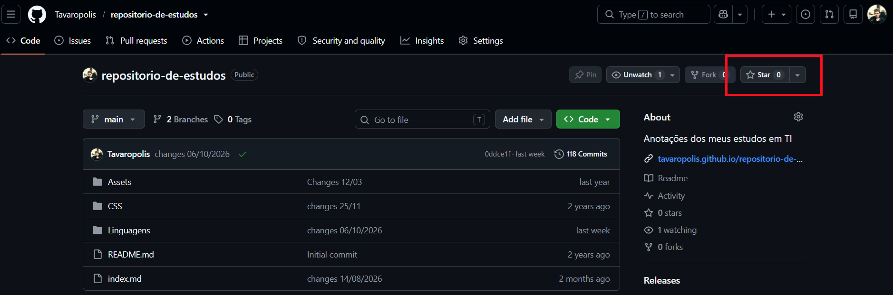

 <link rel="stylesheet" type="text/css" href="../../../CSS/dark-theme.css">

[Anotações](../../) > [Fundamentos](../Index.md) > [Git](./Index.md) > [GitHub Stars](./GitHubStars.md)

# GitHub Stars

As **Stars** são uma funcionalidade do GitHub que permite marcar repositórios como interessantes. Elas ajudam a organizar projetos que você deseja consultar, estudar ou acompanhar futuramente.

Dar uma Star a um repositório não significa copiá-lo para seu computador, fazer um [fork](./GithubFork.md) ou obter permissões adicionais de acesso.

## Como utilizar

### Dar uma Star

1. Acesse o repositório desejado no GitHub.
2. Clique no botão **Star**, normalmente localizado na parte superior direita da página.
3. O repositório será adicionado à sua lista de repositórios marcados.

Ao clicar novamente, você pode remover a Star.

### Consultar suas Stars

Você pode encontrar os repositórios marcados acessando seu perfil no GitHub e procurando a seção **Stars**.

Essa funcionalidade é útil para guardar projetos que servem como referência, bibliotecas que você pretende estudar e ferramentas que podem ser úteis em outros projetos.

## Diferenças entre Star, Fork e Watch

| Funcionalidade | Finalidade |
|---|---|
| **Star** | Marcar um repositório como interessante e facilitar sua localização futura. |
| **Fork** | Criar uma cópia do repositório na sua própria conta do GitHub, permitindo desenvolver uma versão independente. |
| **Watch** | Configurar o acompanhamento de notificações sobre atividades no repositório. |
| **Clone** | Copiar o repositório para o computador, incluindo seu histórico Git. |

## Quando utilizar?

- **Estudo:** guardar projetos com exemplos de código e boas práticas.
- **Referências:** marcar bibliotecas, frameworks e ferramentas úteis.
- **Pesquisa:** organizar repositórios que você pretende analisar futuramente.
- **Descoberta:** demonstrar interesse por projetos públicos e ajudar a sinalizar sua popularidade.

## Observações importantes

- Dar uma Star não instala nem baixa o projeto.
- Uma Star não concede acesso a repositórios privados.
- Uma Star não cria uma cópia independente do projeto.
- Stars e Watch são recursos diferentes: marcar um projeto não significa necessariamente receber notificações de todas as suas atividades.

## Resumo

**Regra prática:** utilize Stars para organizar referências e projetos interessantes; use Fork quando quiser desenvolver uma cópia no GitHub e Clone quando precisar trabalhar com o repositório localmente.